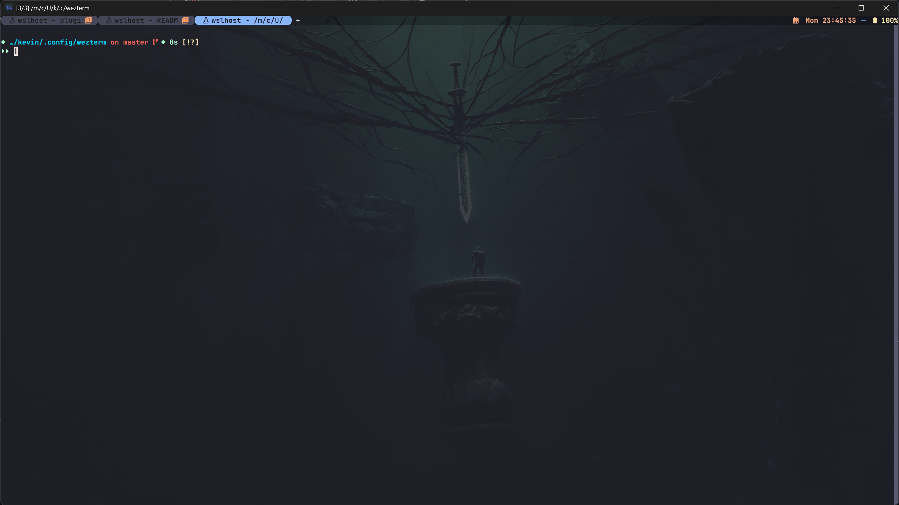

<h2 align="center">My WezTerm Config</h2>

<p align="center">
  <a href="https://github.com/Rayfess/wez-conf/stargazers">
    
  </a>
  <a href="https://github.com/Rayfess/wez-conf/issues">
    
  </a>
  <a href="https://github.com/Rayfess/wez-conf/actions/workflows/lint.yml">
    
  </a>
</p>



---

### Table of Contents

- [Features](#features)
- [Theme](#theme)
- [Getting Started](#getting-started)
- [All Key Bindings](#all-key-bindings)
- [References/Inspirations](#referencesinspirations)
- [License](#license)

---

### Features

- [**GPU Adapter Selector**](https://github.com/Rayfess/wez-conf/blob/master/utils/gpu-adapter.lua)

  > :bulb: Only works if the [`front_end`](https://github.com/Rayfess/wez-conf/blob/master/config/appearance.lua#L8) option is set to `WebGpu`.

  A small utility to select the best GPU + Adapter (graphics API) combo for your machine.

  GPU + Adapter combo is selected based on the following criteria:

  1.  <details>
      <summary>Best GPU available</summary>

      `Discrete` > `Integrated` > `Other` (for `wgpu`'s OpenGl implementation on Discrete GPU) > `Cpu`
      </details>

  2.  <details>
      <summary>Best graphics API available (based off my very scientific scroll a big log file in Neovim test 😁)</summary>

      > :bulb:<br>
      > The available graphics API choices change based on your OS.<br>
      > These options correspond to the APIs the `wgpu` crate (which powers WezTerm's gui in `WebGpu` mode)<br>
      > currently has support implemented for.<br>
      > See: <https://github.com/gfx-rs/wgpu#supported-platforms> for more info

      - Windows: `Dx12` > `Vulkan` > `OpenGl`
      - Linux: `Vulkan` > `OpenGl`
      - Mac: `Metal`

      </details>

- [**Theme Switcher**](https://github.com/Rayfess/wez-conf/blob/master/colors/theme.lua)

  - Follow the OS dark/light appearance and switch live when it changes
  - Runtime fuzzy picker (<kbd>SUPER</kbd>+<kbd>g</kbd>): Custom / Dark / Light, the pick persists across restarts
  - Pin the `colors/custom.lua` palette via the `mode` variable
  - Dark/Light scheme assignments are plain variables with comment/uncomment alternatives

  > See: [Theme](#theme) for configuration

- [**Pill Tab Titles**](https://github.com/Rayfess/wez-conf/blob/master/events/tab-title.lua)

  - Pill-shaped tab titles with process prefix icons (WSL, elevated shells, debug overlay, launcher, input selectors)
  - Per-pane progress indicator via `OSC 9;4` — percentage frames + indeterminate spinner, stale progress is suppressed after 30s
    - Requires WezTerm `Nightly` `20250209-182623-44866cc1` or newer; gracefully disabled on older versions
  - Unseen-output counters (`numbered_box`, `numbered_circle` or plain `circle`)
  - Manual rename, locked until reset

  > See: [key bindings](#tabs-title) for usage

- [**Status Bars**](https://github.com/Rayfess/wez-conf/blob/master/events/left-status.lua)

  - Left: pill indicator showing the active key table name or the leader key glyph
  - Right ([`events/right-status.lua`](https://github.com/Rayfess/wez-conf/blob/master/events/right-status.lua)): live date + battery with a 10-step charging/discharging icon ladder

- [**New-Tab Button Launcher**](https://github.com/Rayfess/wez-conf/blob/master/events/new-tab-button.lua)

  - Right-click the `+` button to fuzzy-launch shells, WSL and SSH domains in a new tab

---

### Theme

The theme switcher lives in [`colors/theme.lua`](./colors/theme.lua). It is configured from the config file and can also be switched at runtime with the fuzzy picker (<kbd>SUPER</kbd>+<kbd>g</kbd>).

```lua
-- Built-in scheme used when the OS is in Dark mode:
local scheme_dark = 'midnight-in-mojave'
-- Built-in scheme used when the OS is in Light mode:
local scheme_light = 'Modus-Operandi'

-- Alternatives — swap by commenting/uncommenting:
-- local scheme_dark = 'Modus-Vivendi'
-- local scheme_light = 'midnight-in-mojave'
```

- **Default (nothing picked yet)** — resolved via [`wezterm.gui.get_appearance()`](https://wezterm.org/config/lua/wezterm.gui/get_appearance.html): OS dark ⇨ `scheme_dark`, OS light ⇨ `scheme_light`. WezTerm re-evaluates the config when the OS appearance changes, so the theme follows live.
- **Custom** — uses the palette defined in [`colors/custom.lua`](./colors/custom.lua), registered as a named scheme; custom scheme names take precedence over built-ins (see [docs](https://wezterm.org/config/appearance.html#defining-a-color-scheme-in-your-weztermlua)).
- **Dark** / **Light** — pin `scheme_dark` / `scheme_light`, ignoring the OS appearance.
- **Runtime picker** — <kbd>SUPER</kbd>+<kbd>g</kbd> opens a fuzzy list with three entries: `Custom`, `Dark`, `Light`. A pick **persists across restarts** (state file `.theme-state`). To reset back to OS-following, delete `.theme-state`.

---

### Getting Started

- #### Requirements:

  - <details>
      <summary><b>WezTerm</b></summary>

    Minimum Version: `20240127-113634-bbcac864`<br>
    Recommended Version: [`Nightly`](https://github.com/wez/wezterm/releases/nightly)

    [Official Installation Page](https://wezfurlong.org/wezterm/installation.html)

    **Windows**

    - <details>
      <summary>Install Stable</summary>

      - Install with Scoop (non-portable)

        ```sh
        scoop bucket add extras
        scoop install wezterm
        ```

      - Install with Scoop (portable)

        ```sh
        scoop bucket add k https://github.com/KevinSilvester/scoop-bucket
        scoop install k/wezterm
        ```

      - Install with winget

        ```sh
        winget install wez.wezterm
        ```

      - Install with choco

        ```sh
        choco install wezterm -y
        ```
      </details>

    - <details>
      <summary>Install Nightly</summary>

      - Install with Scoop (non-portable)

        ```sh
        scoop bucket add versions
        scoop install wezterm-nightly
        ```

      - Install with Scoop (portable)

        ```sh
        scoop bucket add k https://github.com/KevinSilvester/scoop-bucket
        scoop install k/wezterm-nightly
        ```
      </details>

    > :bulb:<br>
    > Toast notifications don't work in non-portable installations.<br>
    > See issue <https://github.com/wez/wezterm/issues/5166> for more details

    ---

    **MacOS**

    - <details>
      <summary>Install Stable</summary>

      - Install with Homebrew

        ```sh
        brew install --cask wezterm
        ```

      - Install with MacPort

        ```sh
        sudo port selfupdate
        sudo port install wezterm
        ```
      </details>

    - <details>
      <summary>Install Nighlty</summary>

      - Install with Homebrew

        ```sh
        brew install --cask wezterm@nightly
        ```

      - Upgrade with Homebrew

        ```sh
        brew install --cask wezterm@nightly --no-quarantine --greedy-latest
        ```
      </details>

    ---

    **Linux**

    Refer to the Linux installation page.<br>
    <https://wezfurlong.org/wezterm/install/linux.html>

    </details>

  - <details>
    <summary>FiraCode Nerd Font</summary>

    Install with Homebrew (Macos)

    ```sh
    brew install --cask font-fira-code-nerd-font
    ```

    Install with Scoop (Windows)

    ```sh
    scoop bucket add nerd-fonts
    scoop install FiraCode-NF
    ```

    > More Info:
    >
    > - <https://www.nerdfonts.com/#home>
    > - <https://github.com/ryanoasis/nerd-fonts?#font-installation>
    </details/>

&nbsp;

- #### Steps:

  1.  ```sh
      # On Windows and Unix systems
      git clone https://github.com/Rayfess/wez-conf.git ~/.config/wezterm
      ```
  2.  Update `launch`, `domain` and `theme` related options:
      - [./config/launch.lua](./config/launch.lua) for preferred shells and its paths
      - [./config/domains.lua](./config/domains.lua) for custom SSH/WSL domains
      - [./colors/theme.lua](./colors/theme.lua) for the theme mode and dark/light scheme assignments
  3.  And Done!!! 🎉🎉

&nbsp;

- #### Optional But Useful:

  - [**`wezterm-types`**](https://github.com/DrKJeff16/wezterm-types): **Highly** recommend setting this up for type completion and inline 
  documentation of every configuration option, events and actions method signatures, etc. Includes type definitions for some popular Wezterm plugins as well.

---

### All Key Bindings

Most of the key bindings revolve around a <kbd>SUPER</kbd> and <kbd>SUPER_REV</kbd>(super reversed) keys.<br>

- On MacOs:
  - <kbd>SUPER</kbd> ⇨ <kbd>Super</kbd>
  - <kbd>SUPER_REV</kbd> ⇨ <kbd>Super</kbd>+<kbd>Ctrl</kbd>
- On Windows and Linux
  - <kbd>SUPER</kbd> ⇨ <kbd>Alt</kbd>
  - <kbd>SUPER_REV</kbd> ⇨ <kbd>Alt</kbd>+<kbd>Ctrl</kbd>

> To avoid confusion when switching between different OS and to avoid conflicting<br>
> with OS's built-in keyboard shortcuts.

- On all platforms: <kbd>LEADER</kbd> ⇨ <kbd>SUPER_REV</kbd>+<kbd>Space</kbd>

#### Miscellaneous/Useful

| Keys                              | Action                                      |
| --------------------------------- | ------------------------------------------- |
| <kbd>F1</kbd>                     | `ActivateCopyMode`                          |
| <kbd>F2</kbd>                     | `ActivateCommandPalette`                    |
| <kbd>F3</kbd>                     | `ShowLauncher`                              |
| <kbd>F4</kbd>                     | `ShowLauncher` <sub>(tabs only)</sub>       |
| <kbd>F5</kbd>                     | `ShowLauncher` <sub>(workspaces only)</sub> |
| <kbd>F11</kbd>                    | `ToggleFullScreen`                          |
| <kbd>F12</kbd>                    | `ShowDebugOverlay`                          |
| <kbd>SUPER</kbd>+<kbd>f</kbd>     | Search Text                                 |
| <kbd>SUPER_REV</kbd>+<kbd>u</kbd> | Open URL                                    |

&nbsp;

#### Copy+Paste

| Keys                                          | Action               |
| --------------------------------------------- | -------------------- |
| <kbd>Ctrl</kbd>+<kbd>Shift</kbd>+<kbd>c</kbd> | Copy to Clipboard    |
| <kbd>Ctrl</kbd>+<kbd>Shift</kbd>+<kbd>v</kbd> | Paste from Clipboard |

&nbsp;

#### Cursor Movements

| Keys                                   | Action                                                     |
| -------------------------------------- | ---------------------------------------------------------- |
| <kbd>SUPER</kbd>+<kbd>LeftArrow</kbd>  | Move cursor to Line Start                                  |
| <kbd>SUPER</kbd>+<kbd>RightArrow</kbd> | Move cursor to Line End                                    |
| <kbd>SUPER</kbd>+<kbd>Backspace</kbd>  | Clear Line <sub>(does not work in PowerShell or cmd)</sub> |

&nbsp;

#### Tabs

##### Tabs: Spawn+Close

| Keys                              | Action                                |
| --------------------------------- | ------------------------------------- |
| <kbd>SUPER</kbd>+<kbd>t</kbd>     | `SpawnTab` <sub>(DefaultDomain)</sub> |
| <kbd>SUPER_REV</kbd>+<kbd>t</kbd> | `SpawnTab` <sub>(WSL:Debian)</sub>    |
| <kbd>SUPER_REV</kbd>+<kbd>w</kbd> | `CloseCurrentTab`                     |

##### Tabs: Navigation

| Keys                              | Action         |
| --------------------------------- | -------------- |
| <kbd>SUPER</kbd>+<kbd>[</kbd>     | Next Tab       |
| <kbd>SUPER</kbd>+<kbd>]</kbd>     | Previous Tab   |
| <kbd>SUPER_REV</kbd>+<kbd>[</kbd> | Move Tab Left  |
| <kbd>SUPER_REV</kbd>+<kbd>]</kbd> | Move Tab Right |

##### Tabs: Toggle Tab-bar

| Keys                          | Action         |
| ----------------------------- | -------------- |
| <kbd>SUPER</kbd>+<kbd>9</kbd> | Toggle tab bar |

##### Tabs: Title

| Keys                              | Action             |
| --------------------------------- | ------------------ |
| <kbd>SUPER</kbd>+<kbd>0</kbd>     | Rename Current Tab |
| <kbd>SUPER_REV</kbd>+<kbd>0</kbd> | Undo Rename        |

&nbsp;

#### Windows

| Keys                          | Action                                                             |
| ----------------------------- | ------------------------------------------------------------------ |
| <kbd>SUPER</kbd>+<kbd>n</kbd> | `SpawnWindow`                                                      |
| <kbd>SUPER</kbd>+<kbd>=</kbd> | Increase Window Size <sub>(disabled on Windows due to a bug)</sub> |
| <kbd>SUPER</kbd>+<kbd>-</kbd> | Decrease Window Size <sub>(disabled on Windows due to a bug)</sub> |

&nbsp;

#### Panes

##### Panes: Split Panes

| Keys                               | Action                                           |
| ---------------------------------- | ------------------------------------------------ |
| <kbd>SUPER</kbd>+<kbd>\\</kbd>     | `SplitVertical` <sub>(CurrentPaneDomain)</sub>   |
| <kbd>SUPER_REV</kbd>+<kbd>\\</kbd> | `SplitHorizontal` <sub>(CurrentPaneDomain)</sub> |

##### Panes: Zoom+Close Pane

| Keys                              | Action                |
| --------------------------------- | --------------------- |
| <kbd>SUPER</kbd>+<kbd>Enter</kbd> | `TogglePaneZoomState` |
| <kbd>SUPER</kbd>+<kbd>w</kbd>     | `CloseCurrentPane`    |

##### Panes: Navigation

| Keys                              | Action                  |
| --------------------------------- | ----------------------- |
| <kbd>SUPER_REV</kbd>+<kbd>k</kbd> | Move to Pane (Up)       |
| <kbd>SUPER_REV</kbd>+<kbd>j</kbd> | Move to Pane (Down)     |
| <kbd>SUPER_REV</kbd>+<kbd>h</kbd> | Move to Pane (Left)     |
| <kbd>SUPER_REV</kbd>+<kbd>l</kbd> | Move to Pane (Right)    |
| <kbd>SUPER_REV</kbd>+<kbd>p</kbd> | Swap with selected Pane |

##### Panes: Scroll Pane

| Keys                          | Action                               |
| ----------------------------- | ------------------------------------ |
| <kbd>SUPER</kbd>+<kbd>u</kbd> | Scroll Lines up <sub>5 lines</sub>   |
| <kbd>SUPER</kbd>+<kbd>d</kbd> | Scroll Lines down <sub>5 lines</sub> |
| <kbd>PageUp</kbd>             | Scroll Page up                       |
| <kbd>PageDown</kbd>           | Scroll Page down                     |

&nbsp;

#### Theme

| Keys                          | Action             |
| ----------------------------- | ------------------ |
| <kbd>SUPER</kbd>+<kbd>g</kbd> | Fuzzy select Theme |

&nbsp;

#### Key Tables

> See: <https://wezfurlong.org/wezterm/config/key-tables.html>

| Keys                           | Action        |
| ------------------------------ | ------------- |
| <kbd>LEADER</kbd>+<kbd>f</kbd> | `resize_font` |
| <kbd>LEADER</kbd>+<kbd>p</kbd> | `resize_pane` |

##### Key Table: `resize_font`

| Keys           | Action                          |
| -------------- | ------------------------------- |
| <kbd>k</kbd>   | `IncreaseFontSize`              |
| <kbd>j</kbd>   | `DecreaseFontSize`              |
| <kbd>r</kbd>   | `ResetFontSize`                 |
| <kbd>q</kbd>   | `PopKeyTable` <sub>(exit)</sub> |
| <kbd>Esc</kbd> | `PopKeyTable` <sub>(exit)</sub> |

##### Key Table: `resize_pane`

| Keys           | Action                                         |
| -------------- | ---------------------------------------------- |
| <kbd>k</kbd>   | `AdjustPaneSize` <sub>(Direction: Up)</sub>    |
| <kbd>j</kbd>   | `AdjustPaneSize` <sub>(Direction: Down)</sub>  |
| <kbd>h</kbd>   | `AdjustPaneSize` <sub>(Direction: Left)</sub>  |
| <kbd>l</kbd>   | `AdjustPaneSize` <sub>(Direction: Right)</sub> |
| <kbd>q</kbd>   | `PopKeyTable` <sub>(exit)</sub>                |
| <kbd>Esc</kbd> | `PopKeyTable` <sub>(exit)</sub>                |

---

### References/Inspirations

- **Based on**: <https://github.com/KevinSilvester/wezterm-config>
- <https://github.com/rxi/lume>
- <https://github.com/catppuccin/wezterm>
- <https://github.com/wez/wezterm/discussions/628#discussioncomment-1874614>
- <https://github.com/wez/wezterm/discussions/628#discussioncomment-5942139>

---

### License

Distributed under the [MIT License](./LICENSE).<br>
© 2026 Rayfess · portions © 2023 Kevin Silvester (original upstream config).
